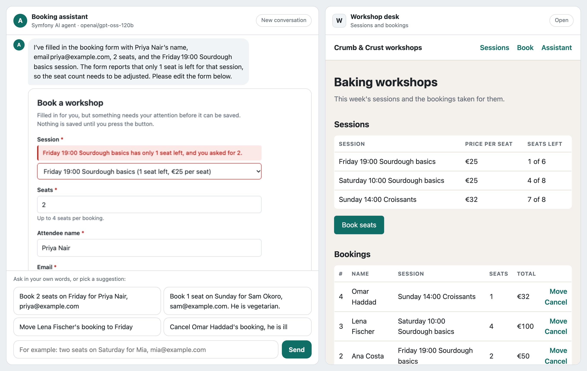
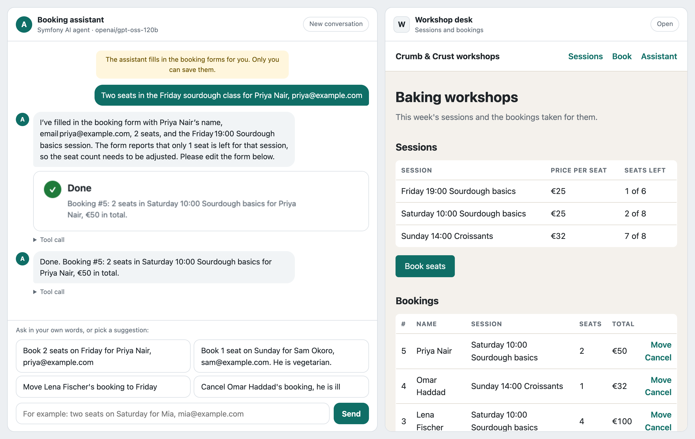

# FormBridge

**The AI fills in your Symfony form, you press the button.**

FormBridge lets an AI assistant use the forms a Symfony application already has. Put one attribute on
an existing form handler and its form becomes a tool for AI agents. The agent fills the form in and
gets the form's own validation back. A person sees the real form, corrects it and submits it. No rule is
written twice, and none of the tools an agent gets can save.



The person picks another session and presses **Book**. The application's normal code makes the
booking:



```php
#[AsFormTool(
    name: 'create_booking',
    form: BookingType::class,
    description: 'Book seats for one person in a workshop session.',
    submitLabel: 'Book',
)]
final class CreateBookingHandler
{
    public function __invoke(BookingRequest $request): Booking { /* your code, unchanged */ }
}
```

Built on Symfony AI 1.0.0-BETA1 (`symfony/ai-agent`, `symfony/ai-platform`, `symfony/mcp-bundle`) and
the official PHP MCP SDK (`mcp/sdk`).

This repository holds the bundle ([`formbridge/`](formbridge)) and **Crumb & Crust workshops**, the
application it is developed against: a bakery's booking desk with three forms (book, move, cancel).

## Quick start

Docker is the only requirement; you do not need an API key.

```bash
git clone https://github.com/harivansh0/formbridge.git && cd formbridge
docker compose up
```

The first start installs the dependencies, runs the migrations and loads the fixtures; it takes about
half a minute. Then:

1. **The assistant:** <http://localhost:8000/assistant>. Click "Book 2 seats on Friday for Priya
   Nair". The assistant fills in the booking form. The form appears in the conversation with a message
   on the field saying that Friday has only one seat left. Pick Saturday, press
   **Book**, and the booking appears on the list next to it.
2. **From an email to a filled-in form:** <http://localhost:8000/book>, then "Paste the message and
   the form is filled in for you". A customer's email is read into the booking form for you to check
   and submit.
3. **One tool call, step by step:**
   [the development preview](http://localhost:8000/_formbridge/preview?tool=create_booking&args=%7B%22session%22%3A%22fri-19%22%2C%22seats%22%3A2%2C%22name%22%3A%22Priya%20Nair%22%2C%22email%22%3A%22priya%40example.com%22%7D)
   shows what the model reads next to what the person sees, and the schema read from the form.

Without `AI_API_KEY` the assistant runs in **offline mode**: a built-in responder answers the
suggested prompts with the tool calls a model makes for them, and the screen says so. Everything
after the model is unchanged: the Symfony AI agent, its tool call, the form rendered by Symfony, the
validation, the booking. Offline mode exists for local development and CI. In `prod` there are no
canned replies: without a key the assistant and the form filler answer with an error.

`docker compose exec app composer db:reset` deletes all bookings and loads the fixtures again. It is
a development command and is not coordinated with requests that are running.

### With a model

The defaults point at [Hugging Face Inference Providers](https://huggingface.co/docs/inference-providers)
with `openai/gpt-oss-120b`. Create `.env.local` next to `.env` with a token that may call Inference
Providers:

```dotenv
AI_API_KEY=hf_...
```

The assistant then takes free text, for example "two seats for Mia, mia@example.com, on the first day
that still has room for both of us" or, after a booking, "now move that booking to Sunday". The
screenshots above were taken this way.

In production, keep the key in Symfony's secrets vault (`bin/console secrets:set AI_API_KEY`)
rather than in a file.

Any other OpenAI-compatible endpoint works too:

```dotenv
AI_API_KEY=sk-...
AI_BASE_URL=https://api.openai.com
AI_MODEL=gpt-5-mini
```

### In an MCP client

The MCP endpoint is `http://localhost:8000/mcp`; the same server also speaks STDIO.

- **Claude Desktop** (shows the form inside the conversation). Add this to
  `~/Library/Application Support/Claude/claude_desktop_config.json`, with the full path of `docker`
  (`which docker`) and of this folder, and restart Claude Desktop while `docker compose up` is running:

  ```json
  {
    "mcpServers": {
      "workshops": {
        "command": "/usr/local/bin/docker",
        "args": ["compose", "-f", "/absolute/path/to/this/folder/compose.yaml", "exec", "-T", "app", "php", "bin/console", "mcp:server"]
      }
    }
  }
  ```

- **Claude Code** (no forms in the conversation, so the assistant hands over a link to the same form):
  `claude mcp add --transport http workshops http://localhost:8000/mcp`
- **MCP Inspector:** `npx @modelcontextprotocol/inspector`, connect to `http://localhost:8000/mcp`.

## What one attribute gives you

| | What it is | Built on |
|---|---|---|
| An MCP tool | `create_booking`: its input schema is read from the form's fields, choices, labels, help texts and validation constraints. Calling it fills the form in and validates it; it never saves | `mcp/sdk`, `symfony/mcp-bundle` |
| The form inside the conversation | The same form, rendered by Symfony with Twig, shown by the client as an MCP App, with each validation message on its field | MCP Apps (`#[AsMcpApp]`) |
| A submit tool for that form only | `create_booking_submit` runs your handler when the person presses the button. It is marked as not for the model, and it needs a token that only the form carries | MCP Apps tool visibility |
| A tool for Symfony AI agents | The same form as a tool of any agent named under `form_bridge.agents`, straight through the service layer, with no tool for saving at all | `symfony/ai-agent` |
| A "paste a message" page | Free text is read into the form by a model whose structured output has the form's own schema | `symfony/ai-platform` |
| A review link | The filled-in form on a normal web page, for clients that cannot show forms | Symfony Form, Twig |

Every further form needs one more attribute: `RescheduleBookingHandler` and `CancelBookingHandler`
are exposed the same way.

## How it works

Every FormBridge caller follows the same path through the application's own form.

| Step | What happens | Where |
|---|---|---|
| Boot | Services carrying `#[AsFormTool]` are collected | `FormBridgeBundle`, `FormToolPass` |
| Describing a form | Field types, the choices the form would offer (submitted values, not labels), labels, help texts and constraints become a JSON Schema | `Form/FormSchemaFactory` |
| An agent calls the tool | The values go through the real form. Nothing is saved. The answer is text for the model, structured data, and the form rendered by Symfony. A draft is opened for the person | `FormToolRunner::draft()`, `DraftStore` |
| The person presses the button | The draft is claimed, the form validates again, and the application's handler runs | `DraftStore::claim()`, `FormToolRunner::submit()` |
| The handler refuses after all | It throws `ValidationFailedException`; its messages are shown on the form | `FormToolRunner::submit()` |

### Who can save

- **No tool an agent is given can save.** The tool a model sees only fills in and validates. A
  Symfony AI agent gets no other tool. Over MCP the submit tool is marked for the form only, which
  clients that support MCP Apps respect.
- **The submit tool needs a token the model is not given.** The token is inside the rendered form,
  which travels in the part of a tool result that clients keep out of the model's context (`_meta`).
  It is the server's own check for clients that do not hide the tool.
- **A draft is saved at most once.** The form in the conversation and the review page are two ways
  to the same draft. Attempts are taken one at a time (`symfony/lock`). The draft is closed before
  the handler runs, so an attempt that is cut off after saving cannot be repeated. It is reopened,
  with its original expiry, in two cases only: the form was not valid, or the handler refused it
  with a `ValidationFailedException`. Handlers must refuse before writing, never after.
- **The review link is not authentication.** An agent passes the link on. A bare request to it does
  not save, because submitting needs a CSRF token issued when the page is loaded. Any program that
  can load a page and post a form can do both steps, though. The review page is an ordinary route of
  your application: put it behind your access control to decide who may save, or switch it off with
  `review_page: false`. A listener of `FormSubmitEvent` can refuse a save whichever way it arrives.

### What the schema enforces

- Field names and types are enforced, inside nested groups too: the MCP SDK rejects a call that
  breaks them before the form runs, with its own message.
- Choice lists are described, not enforced. Each choice field lists the values the form would
  submit with their labels. A schema is read once and then kept by clients and by long-running
  servers, while choices often come from data that changes, so an enforced list would reject a
  booking made a minute ago. The form always knows the current list and answers with it.
- Ranges, lengths and required fields are written into the field descriptions and left to the
  form, so a wrong value still reaches the form, which answers in the application's own words and
  shows the person the field to correct.

For every value the schema lets through, the application's pages and the tool give the same
validation messages, because both run the same form.

### Concurrency

Submitting validates again, and the handler has the last word. The three booking handlers run
through `App\Booking\LockedOperation`: it locks the booking being changed and the session that
would receive seats, in a fixed order, reloads them, and validates the request again before
anything is written. The free seats are counted in the database at that moment. A booking and a move cannot
both get the last seat, and a booking cannot be cancelled twice. It refuses to run inside a caller's
transaction, because its locks are released when it returns.

## Using the bundle

The bundle is its own Composer package in [`formbridge/`](formbridge); the application installs it
through a path repository. It is also published on its own, as a read-only copy of that folder, at
<https://github.com/harivansh0/formbridge-bundle>.

```yaml
# config/packages/form_bridge.yaml
form_bridge:
    agents: ['assistant']          # Symfony AI agents (under ai.agent) that get every form tool
    mcp_servers: ['default']       # MCP servers (under mcp.servers) that expose them; empty: all
    review_page: true              # also offer the form as a link, for clients that cannot show forms
    drafts:
        lifetime: 3600             # seconds a filled-in form stays open for the person
        cache_pool: cache.app      # optional: where filled-in forms are kept
    fill:                          # the "paste a message" page
        platform: 'ai.platform.openai'
        model: 'gpt-5-mini'
        rate_limiter: assistant    # optional: a limiter under framework.rate_limiter
```

```yaml
# config/routes/form_bridge.yaml
form_bridge:
    resource: '@FormBridgeBundle/config/routes.php'
```

The bundle's own documentation is in [`formbridge/docs/index.md`](formbridge/docs/index.md).

The handler receives the form's data once the form is valid. What it returns is shown to the person
as the confirmation (a string or a `Stringable`). The application needs `framework.lock` and CSRF
protection enabled, which `symfony/lock` and `symfony/security-csrf` set up.

**Extension points.** An application can describe its own field types and constraints to agents
(`FieldDescriberInterface`, `ConstraintDescriberInterface`), override the templates, and refuse a
save from a listener of `FormBridge\Event\FormSubmitEvent`, which is where to decide who may use
which form. [`formbridge/docs/index.md`](formbridge/docs/index.md) has examples.

**Events.** `FormBridge\Event\FormDraftedEvent` is dispatched when an agent has filled a form in, and
`FormBridge\Event\FormSavedEvent` when a form submitted through FormBridge (in the conversation or on
the review page) was saved; the latter carries the form data and the handler's result. Pages of your
own that call the same handler directly do not pass through FormBridge and raise no event. FormBridge
logs both steps on the `form_bridge` channel, without field values. The MCP SDK, however, logs complete
tool arguments at debug level, so keep its `mcp` channel above debug (see
`config/packages/monolog.yaml`).

**Inspecting.** `bin/console debug:form-tools` lists the registered forms and whether each can be
exposed;
`bin/console debug:form-tools create_booking` prints what an agent is told about one, including its
input schema.

**Supported fields:** text, textarea, email, URL, integer, number, checkbox, single and multiple
choice, enums, Doctrine entities, date, date and time, time (each as one text value in the standard
HTML5 format), and nested groups. Buttons are left out. File uploads, collections, dates or times
split over several controls, times without minutes, and dates in a custom text format raise an
error rather than being described wrongly.

**Limitations:**

- The texts the bundle shows to people come in English, German and French; other languages need a
  translation file in the application. What the model reads is always English.
- Forms that change their fields while being submitted (form events) are not handled specially.
- Labels given as translatable objects are not carried into the schema.
- Only rules of the default validation group are described, and only these constraints: `NotBlank`,
  `NotNull`, `Range`, `Positive`, `PositiveOrZero`, `Length` and `Email`. Every other rule is still
  enforced by the form, but the agent learns of it from the form's answer.
- A choice field lists all its options in the tool description, and option labels often hold text
  that users entered (a booking's name here). The list is marked as data for the model, and saving
  never depends on the model, but a field with thousands of options makes for a very large schema.
- An empty nested group sent as `{}` is rejected by the MCP SDK before the form runs (upstream
  finding 11). Leave the group out instead.
- Number fields that use digit grouping in a locale where "." is the grouping sign are not supported.
- A handler's refusal is put on the field with the same name as its path; forms that rename fields
  with `property_path` get it on the form as a whole.
- The name of a form tool and that name with `_submit` appended are taken. A clash with another
  form or with a `#[McpTool]` service fails at compile time; tools registered in other ways are not
  checked, and the MCP registry would let them replace a form's tool.

## Repository layout

| Path | What it holds |
|---|---|
| `formbridge/src/Form/FormSchemaFactory.php` | A form read as a tool schema |
| `formbridge/src/FormToolRunner.php` | The path every FormBridge caller takes; events and logging |
| `formbridge/src/DraftStore.php` | A draft that can be reached in two ways and saved at most once |
| `formbridge/src/Mcp/` | The MCP tools, the MCP App (one static shell for all forms), and `FreshStateListener`, which keeps a long-running STDIO server from answering with stale data |
| `formbridge/templates/app.html.twig` | The form screen, and where it departs from the MCP bundle's bridge |
| `formbridge/src/Agent/FormToolbox.php` | The forms as tools of a Symfony AI agent |
| `formbridge/src/Ai/FormFiller.php` | Structured output in the shape of a form |
| `src/Booking/` | The three handlers with their attribute, and `LockedOperation`. The application's own pages call the same handlers |
| `src/Assistant/` | The Symfony AI agent behind `/assistant`, its platform and the offline responder |
| `migrations/`, `src/DataFixtures/` | The schema and the fixtures |

## Development

```bash
docker compose exec app php bin/phpunit
docker compose exec app vendor/bin/phpstan analyse      # level 8
docker compose exec app vendor/bin/php-cs-fixer fix     # @Symfony
docker compose exec app composer check                  # all of the above, plus linting and schema validation
```

`php bin/phpunit` runs 147 tests: 72 of the application in `tests/` and 75 of the package in
`formbridge/tests/`. The package's tests use a small application of their own (`tests/App`), so
they also run in the package's repository, on PHP 8.2 with Symfony 7.4 and on PHP 8.4 with
Symfony 8.1.

Among them: the same validation messages from the application's pages and over MCP
(`McpEndpointTest`, `WebsiteAndToolParityTest`), each supported kind of field (`FieldTypesTest`),
saving once whichever way is used (`SavingOnceTest`, `ReviewPageTest`, `DraftStoreTest`), an agent
correcting itself from the form's answer (`FormToolboxTest`), the last seat for a booking and for a
move and seats released by another request (`LastSeatTest`), cancelling (`CancelBookingTest`), the
limit on questions and pasted messages (`AssistantTest`, `FillPageTest`), tool-name clashes and
server scoping (`WiringTest`), refusing a save from a listener (`FormToolRunnerTest`), translated
texts (`TranslationTest`), and a real long-running server process that must show a booking made
elsewhere (`StdioServerTest`). The tests run without a provider key.

## Status

Verified beyond the automated tests:

- Over HTTP and STDIO: handshake, tool list, drafts, saving, the token, and a whole conversation in
  one long-running STDIO process.
- In Chrome: the form in a sandboxed frame, validation messages, multiple-choice and nested fields,
  saving, the review page, the "paste a message" page and the assistant screen.
- With `openai/gpt-oss-120b` through Hugging Face: the agent picks the right form and values from
  free text, leaves out what it was not told, follows up within a conversation, and does not claim a
  booking when told to skip the form. The form filler reads a customer's email into the booking form
  through structured output.
- In Claude Desktop over STDIO: the booking form appears inside the conversation, and pressing
  **Book** there saves the booking through the form-only submit tool.

Not covered yet:

- Other MCP clients (ChatGPT, Cursor, VS Code).
- Truly simultaneous requests. The locks are tested by running the competing steps one after the
  other, not in parallel.
- The form screen's own script (message checks, sending the form, resizing) has no automated test.
- No test calls a real model.
- A production install (`composer install --no-dev`, `APP_ENV=prod`). The Docker setup is a
  development stack.
- Versions in between: the package is tested on PHP 8.2 with Symfony 7.4 and on PHP 8.4 with
  Symfony 8.1, the application on PHP 8.4 with Symfony 8.1 only.
- An application with several MCP servers: scoping the form tools to some of them is tested at the
  container level, not against running servers.

Deployment notes for the workshops application:

- It has no authentication. `compose.yaml` binds it to the loopback interface, the MCP endpoint
  accepts browser requests only from its own pages and, in development, from the MCP Inspector, and
  the preview page exists in debug mode only.
- No page may be shown inside a frame of another site (`App\EventListener\FrameGuardListener`),
  since every page has a button that saves.
- Questions to the assistant and messages pasted for the form filler are limited to 20 per minute
  per client address (`config/packages/rate_limiter.yaml`). One question can lead to several requests
  to the model provider (a tool call, then the answer), so this bounds usage without counting
  provider requests. The address is that of the direct peer: behind a reverse proxy, configure
  trusted proxies, or all visitors share one limit.
- Its pages carry their styles and scripts inline instead of going through AssetMapper, and its
  own texts are not translated. Both keep it to one `docker compose up` with nothing to build.
- Offline mode builds its canned replies with `MockPlatformFactory`, a test helper of
  `symfony/ai-platform`; it is never used when a key is set.
- In the development preview and on the assistant screen the form frame has no access to the page
  around it or its cookies, and a content policy stops it from loading resources or sending
  requests; it does not stop the frame from navigating itself elsewhere.

## Upstream findings

These issues were found while building on the pre-releases. The first is confirmed against the current
`main`; the others were seen on `symfony/ai` 1.0.0-BETA1 and `mcp/sdk` 0.9.0.

1. **`symfony/ai-bundle` breaks the container when `symfony/security-core` is installed without
   SecurityBundle.** `composer require symfony/form symfony/security-csrf symfony/ai-bundle` in a new
   skeleton fails with `The service "ai.security.is_granted_attribute_listener" has a dependency on a
   non-existent service "security.authorization_checker"`. The bundle keeps the listener whenever the
   security-core class exists, but the service it needs comes from SecurityBundle. Worked around in
   `src/Kernel.php`.
2. `symfony/mcp-bundle`: after `composer require`, the HTTP endpoint answers 500 until a PSR-17
   implementation such as `nyholm/psr7` is installed.
3. `@Mcp/app/base.html.twig`: a frame can grow but not shrink, because `reportSize()` measures the
   document, which is never shorter than the frame.
4. Same template: a frame scrolled out of view does not report a new size (seen in Chrome), so it
   stays at its first height until it becomes visible.
5. Same template: `<form data-call>` collects fields with `Object.fromEntries(new FormData(form))`,
   which keeps only the last value of a multiple-choice field and leaves out the pressed button.
6. Same template: its `message` listener accepts messages from any window, not only from the client
   that embeds the screen.
7. Same template: `render()` copies every text or number of a tool result into a form control of
   the same name, so a field called `html`, for example, is overwritten with the result's own data.
8. HTML-over-the-wire puts the rendered `html` into `structuredContent`; `_meta` would keep it out
   of the model's context on clients that pass `structuredContent` to the model.
9. `symfony/mcp-bundle` passes `allowed_origins` to the DNS-rebinding check but not to the SDK's
   CORS middleware, so no `Access-Control-Allow-Origin` header is sent and a browser-based client
   needs it from elsewhere (this application uses NelmioCorsBundle, in development only).
10. `bin/console mcp:server` serves a whole conversation from one process without resetting
    services between requests, so Doctrine entities and cached choice lists go stale: a booking
    made in another process did not show up in a form asked for afterwards.
11. `mcp/sdk`: an empty object inside the arguments of a tool call, such as `{"address": {}}`, is
    rejected with `Expected object, but received array`, although it matches the tool's schema.
    Only an empty object at the top level is handled.

12. `mcp/sdk` logs the complete arguments of every tool call at debug level (`CallToolHandler`),
    which puts personal data, and any token passed as an argument, into a debug log.

Numbers 3 to 7 are worked around in `formbridge/templates/app.html.twig`, number 8 in
`formbridge/src/Mcp/FormToolResponder.php` together with that template, number 10 in
`formbridge/src/Mcp/FreshStateListener.php`, and number 12 in `config/packages/monolog.yaml`.

## License

MIT, see [LICENSE](LICENSE).
