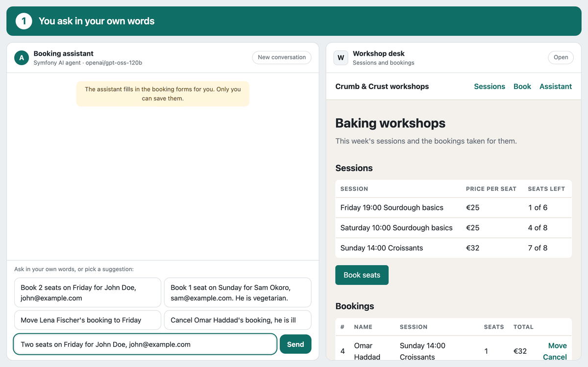

# FormBridge

**The AI fills in your Symfony form. You press the button.**

Add one attribute to a form handler you already have. Its form becomes a tool for AI assistants.

- The assistant fills the form in and gets your form's own error messages back.
- You see the real form in the chat, fix what is wrong and submit it.
- The assistant has no tool that saves. Your own code saves, after you press the button.



```php
#[AsFormTool(
    name: 'create_booking',
    form: BookingType::class,
    description: 'Book seats for one person in a workshop session.',
    submitLabel: 'Book',
)]
final class CreateBookingHandler
{
    public function __invoke(BookingRequest $request): Booking { /* your code, unchanged */ }
}
```

## Try it

You need Docker. You do not need an API key: without one, the assistant answers the suggested
requests and the example email with fixed replies.

```bash
git clone https://github.com/harivansh0/formbridge.git && cd formbridge
docker compose up
```

The first start builds the image and installs the dependencies. When the terminal prints
`Application: http://localhost:8000`, open:

- <http://localhost:8000/assistant> and click "Book 2 seats on Friday for John Doe,
  john@example.com". The form answers that Friday has one seat left. Pick Saturday and press
  **Book**.
- <http://localhost:8000/book> and choose "Paste the message and the form is filled in for you". It
  turns a customer's email into a filled-in form.

[Setup](docs/setup.md) shows how to add a real model, Claude Desktop or another MCP client.

## Use it in your project

```bash
composer require formbridge/formbridge-bundle
```

Your application must allow beta packages, because Symfony's MCP bundle is still a pre-release.
[Installation](formbridge/docs/index.md#installation) has the steps. Then put `#[AsFormTool]` on a
handler. [The bundle's documentation](formbridge/docs/index.md) covers configuration, events and
limits.

## What you get

| | What it does | Built on |
|---|---|---|
| An MCP tool | Fills the form in and checks it. It never saves | `mcp/sdk`, `symfony/mcp-bundle` |
| The form in the chat | Your form, rendered by Symfony, with each error on its field | MCP Apps |
| A tool for your own agent | The same form for a Symfony AI agent | `symfony/ai-agent` |
| A "paste a message" page | A model reads plain text into the form | `symfony/ai-platform` |
| A review link | The filled-in form on a web page, for clients that cannot show forms | Symfony Form, Twig |


[How it works](docs/how-it-works.md) explains who can save, what is checked where, and why two
people cannot get the last seat.

## In this repository

- [`formbridge/`](formbridge) is the bundle, published as
  [`formbridge/formbridge-bundle`](https://packagist.org/packages/formbridge/formbridge-bundle).
- The rest is **Crumb & Crust workshops**, a bakery's booking desk. It uses the bundle for its
  three forms: book, move and cancel.

Built on Symfony AI 1.0.0-BETA1 and the official PHP MCP SDK.

## More

- [Tests and status](docs/status.md): 152 tests, what was checked by hand, and what is not covered yet.
- [Upstream findings](docs/upstream-findings.md): twelve issues found in the pre-releases while
  building this, with the workarounds and the limits that remain.

## License

MIT, see [LICENSE](LICENSE).
